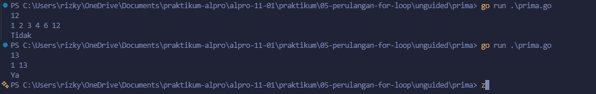
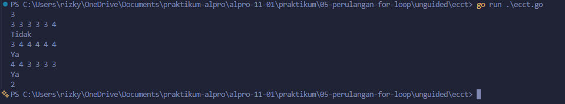

# <h1 align="center">Laporan Praktikum Modul 05 - “PERULANGAN FOR”</h1>
<p align="center">[Rizky Fadlurrahman ramadhan] - [109092630002]</p>

## Dasar Teori

### A. Perulangan For di Go
Perulangan `for` menjalankan perintah yang sama secara berulang tanpa menulis kode berkali-kali, dan merupakan satu-satunya perulangan di Go. Bentuk tiga komponennya adalah `for inisialisasi; kondisi; post statement { ... }`: inisialisasi dijalankan sekali di awal, kondisi dicek sebelum tiap putaran, dan post statement dijalankan setelah tiap putaran

### B. For Hanya Kondisi dan Perulangan Bersarang
Karena Go tidak punya `while`, perannya digantikan oleh `for` yang hanya berisi kondisi. `for` juga bisa diletakkan di dalam `for` lain (perulangan bersarang) untuk memproses data yang tiap itemnya punya beberapa nilai

## Guided

### 1. tabungan.go

```go
package main

import "fmt"

func main() {
	var a, b, n int
	fmt.Scan(&a, &b, &n)

	total := 0;
	tabunganHariIni := a;

	for i := 1; i <= n; i++ {
		total = total + tabunganHariIni
		tabunganHariIni = tabunganHariIni + b
	}
	fmt.Println(total)
}
```

#### Deskripsi
Program ini menghitung total tabungan selama n hari. Tabungan hari itu dijumlahkan ke `total`, lalu dinaikkan sebesar b di setiap putaran

### 2. terbesar.go

```go
package main

import "fmt"

func main() {
	var n int
	fmt.Scan(&n)

	var angka, max int
	fmt.Scan(&angka)

	for i := 2; i < n; i++ {
		fmt.Scan(&angka)

		if angka > max {
			max = angka
		}
	}
	fmt.Println(max)
}
```

#### Deskripsi
Program ini mencari bilangan terbesar dari n bilangan. Angka dibaca di dalam perulangan, dan `max` diperbarui jika ada angka yang lebih besar

### 3. bioskop.go

```go
package main

import "fmt"

func main() {
	var t int
	fmt.Print("input t (jumlah transaksi): ")
	fmt.Scan(&t)

	totalPendapatan := 0

	for i := 1; i <= t; i++ {
		var jenisFilm, hari string
		var jumlahTiket int

		fmt.Printf("input transaksi ke-%d (jenis, hari, tiket): ", i)
		fmt.Scan(&jenisFilm, &hari, &jumlahTiket)

		hargaSatuan := 0

		if jenisFilm == "Reguler" {
			if hari == "Senin" || hari == "Selasa" || hari == "Rabu" || hari == "Kamis" {
				hargaSatuan = 40000
			} else {
				hargaSatuan = 50000
			}
		} else if jenisFilm == "3D" {
			if hari == "Senin" || hari == "Selasa" || hari == "Rabu" || hari == "Kamis" {
				hargaSatuan = 60000
			} else {
				hargaSatuan = 70000
			}
		} else if jenisFilm == "IMAX" {
			if hari == "Senin" || hari == "Selasa" || hari == "Rabu" || hari == "Kamis" {
				hargaSatuan = 80000
			} else {
				hargaSatuan = 90000
			}
		}

		totalHarga := hargaSatuan * jumlahTiket

		if jumlahTiket >= 5 {
			diskon := (totalHarga * 10) / 100
			totalHarga = totalHarga - diskon
		}

		fmt.Printf("output total harga transaksi ke-%d: %d\n", i, totalHarga)

		totalPendapatan = totalPendapatan + totalHarga
	}

	fmt.Println("output total pendapatan:", totalPendapatan)
}
```

#### Deskripsi
Program ini menghitung total harga tiap transaksi bioskop dan total pendapatannya. Harga satuan ditentukan oleh jenis film dan hari, lalu diberi diskon 10% jika tiket ≥ 5

## Unguided

### 1. prima

```go
package main

import "fmt"

func main() {
	var n int
	fmt.Scan(&n)

	jumlah := 0
	for i := 1; i <= n; i++ {
		if n%i == 0 {
			if jumlah > 0 {
				fmt.Print(" ")
			}
			fmt.Print(i)
			jumlah++
		}
	}
	fmt.Println()

	if jumlah == 2 {
		fmt.Println("Ya")
	} else {
		fmt.Println("Tidak")
	}
}
```

##### Output


#### Deskripsi
Program ini mencetak semua faktor dari n dan menentukan apakah n prima. Bilangan disebut prima jika jumlah faktornya tepat 2

### 2. ecct

```go
package main

import "fmt"

func main() {
	var m, nilai, lulus int
	fmt.Scan(&m)

	for i := 0; i < m; i++ {
		jumlah := 0
		for j := 0; j < 6; j++ {
			fmt.Scan(&nilai)
			jumlah += nilai
		}

		rata := float64(jumlah) / 6
		if rata >= 3.33 {
			fmt.Println("Ya")
			lulus++
		} else {
			fmt.Println("Tidak")
		}
	}
	fmt.Println(lulus)
}
```

##### Output


#### Deskripsi
Program ini menentukan apakah tiap mahasiswa mendapat sertifikat ECCT. Enam nilai dijumlahkan dalam perulangan bersarang, dan mahasiswa lulus jika rata-ratanya ≥ 3.33

## Kesimpulan
Praktikum ini melatih penggunaan perulangan `for` untuk mengulang proses sesuai kebutuhan, seperti menjumlahkan data, mencari nilai terbesar, dan menghitung transaksi. Perulangan juga bisa digabung dengan percabangan dan perulangan bersarang untuk mengolah data yang lebih kompleks

## Referensi
1. The Go Authors. (2024). The Go Programming Language Specification. Diakses melalui https://go.dev/ref/spec
2. Donovan, A. A., & Kernighan, B. W. (2015). The Go Programming Language. New York: Addison-Wesley
3. Laboratorium Praktikum Informatika. (2025). Modul 05: Perulangan For - Algoritma dan Pemrograman. Bandung: Fakultas Informatika, Universitas Telkom