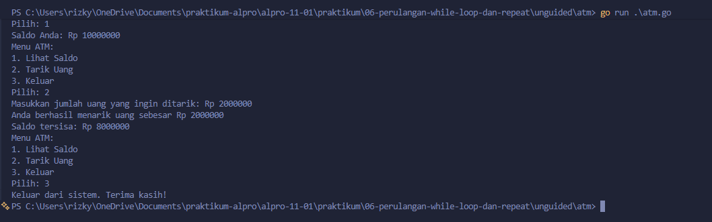

# <h1 align="center">Laporan Praktikum Modul 06 - “PERULANGAN WHILE”</h1>
<p align="center">[Rizky Fadlurrahman ramadhan] - [109092630002]</p>

## Dasar Teori

### A. Perulangan While di Go
Di Go tidak ada `while` atau `do-while`. Gantinya, kita pakai `for` yang isinya cuma kondisi, yaitu `for kondisi { ... }`. Isinya diulang terus selama kondisinya masih true, jadi cocok kalau jumlah ulangannya belum diketahui.

### B. Kondisi Berhenti dan Penelusuran String
Perulangan while biasanya dihentikan lewat nilai tertentu, batas percobaan, atau pilihan keluar di menu. Kalau datanya string, tiap karakter bisa dicek pakai indeks `kalimat[i]`, dan panjangnya didapat dari `len(kalimat)`.

## Guided

### 1. terkecil.go

```go
package main

import "fmt"

func main() {
    var batas int
    fmt.Scan(&batas)

    n := 1
    for n*n*n <= batas {
        n++
    }

    fmt.Println(n)
}
```

#### Deskripsi
Program ini mencari n paling kecil yang n pangkat tiganya lebih dari batas. Selama n³ belum melewati batas, n ditambah 1.

### 2. terbesar.go

```go
package main

import "fmt"

func main() {
    var batas int
    fmt.Scan(&batas)

    n := 1
    for n*n < batas {
        n++
    }

    fmt.Println(n - 1)
}
```

#### Deskripsi
Program ini mencari n paling besar yang kuadratnya masih di bawah batas. n ditambah 1 sampai n² mencapai batas, lalu yang dicetak n - 1 karena n terakhir sudah melewati batas.

### 3. vokal.go

```go
package main

import (
    "bufio"
    "fmt"
    "os"
    "strings"
)

func main() {
    reader := bufio.NewReader(os.Stdin)
    kalimat, _ := reader.ReadString('\n')

    i := 0
    jumlahVokal := 0

    for i < len(kalimat) {
        ch := strings.ToLower(string(kalimat[i]))
        if ch == "a" || ch == "i" || ch == "u" || ch == "e" || ch == "o" {
            jumlahVokal++
        }
        i++
    }

    fmt.Println(jumlahVokal)
}
```

#### Deskripsi
Program ini menghitung jumlah huruf vokal dalam kalimat. Kalimat dibaca satu baris, lalu tiap karakternya diubah ke huruf kecil dan dicek apakah a, i, u, e, atau o.

## Unguided

### 1. atm

```go
package main

import "fmt"

func main() {
	benar := "1234"
	saldo := 10000000
	kesempatan := 0
	login := false

	for kesempatan < 3 && !login {
		var password string
		fmt.Print("Masukkan password ATM: ")
		fmt.Scan(&password)

		if password == benar {
			login = true
		} else {
			fmt.Println("Password salah. Silakan coba lagi.")
			kesempatan++
		}
	}

	if !login {
		fmt.Println("ATM terblokir. Program selesai.")
		return
	}

	fmt.Println("Login berhasil!")

	pilihan := 0
	for pilihan != 3 {
		fmt.Println("Menu ATM:")
		fmt.Println("1. Lihat Saldo")
		fmt.Println("2. Tarik Uang")
		fmt.Println("3. Keluar")
		fmt.Print("Pilih: ")
		fmt.Scan(&pilihan)

		if pilihan == 1 {
			fmt.Println("Saldo Anda: Rp", saldo)
		} else if pilihan == 2 {
			var jumlah int
			fmt.Print("Masukkan jumlah uang yang ingin ditarik: Rp ")
			fmt.Scan(&jumlah)

			if jumlah <= saldo {
				saldo -= jumlah
				fmt.Println("Anda berhasil menarik uang sebesar Rp", jumlah)
				fmt.Println("Saldo tersisa: Rp", saldo)
			} else {
				fmt.Println("Saldo tidak mencukupi.")
			}
		} else if pilihan == 3 {
			fmt.Println("Keluar dari sistem. Terima kasih!")
		}
	}
}
```

##### Output


#### Deskripsi
Program ini meniru ATM dengan dua perulangan. Yang pertama untuk login dengan password "1234" dan maksimal 3 kali coba, kalau salah semua ATM diblokir. Yang kedua menampilkan menu saldo, tarik uang, dan keluar sampai pilihan 3 dipilih.

## Kesimpulan
Di Go, perulangan while dibuat dengan `for` yang hanya berisi kondisi, dan pas dipakai kalau jumlah ulangannya belum pasti. Di praktikum ini dipakai untuk mencari bilangan sesuai syarat, menghitung vokal lewat indeks, dan membuat simulasi ATM yang punya batas percobaan login serta menu yang terus muncul.

## Referensi
1. The Go Authors. (2024). The Go Programming Language Specification. Diakses melalui https://go.dev/ref/spec
2. Donovan, A. A., & Kernighan, B. W. (2015). The Go Programming Language. New York: Addison-Wesley
3. Laboratorium Praktikum Informatika. (2025). Modul 06: Perulangan While - Algoritma dan Pemrograman. Bandung: Fakultas Informatika, Universitas Telkom