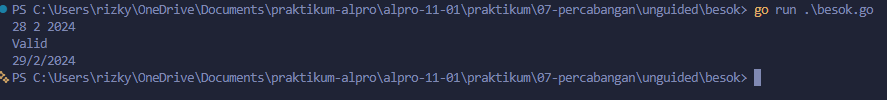
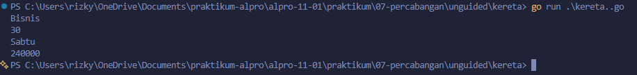

# <h1 align="center">Laporan Praktikum Modul 07 - “PERCABANGAN”</h1>
<p align="center">[Rizky Fadlurrahman Ramadhan] - [109092630002]</p>

## Dasar Teori

### A. Percabangan If
Percabangan digunakan agar program dapat memilih tindakan berdasarkan kondisi. `if` menjalankan perintah jika kondisi benar, `if-else` memilih salah satu dari dua jalur, sedangkan `else if` memeriksa beberapa kondisi secara berurutan

### B. Switch dan Operator Logika
`switch` digunakan untuk memilih perintah berdasarkan nilai tertentu. Di Go, `switch` berhenti setelah menemukan `case` yang cocok. Operator `&&` berarti dan, `||` berarti atau, sedangkan `!` berarti negasi

## Guided

### 1. kabisat.go

```go
package main

import "fmt"

func main() {
	var tahun int
	fmt.Scan(&tahun)

	if (tahun % 400 == 0) || (tahun%4 == 0 && tahun%100 != 0) {
		fmt.Println("Ya")
	} else {
		fmt.Println("Tidak")
	}
}
```

#### Deskripsi
Program menentukan apakah suatu tahun termasuk tahun kabisat berdasarkan aturan pembagian 4, 100, dan 400

### 2. segitiga.go

```go
package main

import "fmt"

func main() {
	var a, b, c int
	fmt.Scan(&a, &b, &c)

	if a <= 0 || b <= 0 || c <= 0 || a+b <= c || a+c <= b || b+c <= a {
		fmt.Println("Bukan segitiga")
	} else if a == b && b == c {
		fmt.Println("Segitiga sama sisi")
	} else if a == b || a == c || b == c {
		fmt.Println("Segitiga sama kaki")
	} else {
		fmt.Println("Segitiga sembarang")
	}
}
```

#### Deskripsi
Program memeriksa validitas panjang sisi, kemudian menentukan jenis segitiga sama sisi, sama kaki, atau sembarang

### 3. kalkulator.go

```go
package main

import "fmt"

func main() {
	var a, b int
	var op string

	fmt.Scan(&a, &op, &b)

	switch op {
	case "+":
		fmt.Println(a + b)
	case "-":
		fmt.Println(a - b)
	case "*":
		fmt.Println(a * b)
	case "/":
		if b == 0 {
			fmt.Println("Error: pembagian dengan nol")
		} else {
			fmt.Printf("%.2f\n", float64(a)/float64(b))
		}
	case "%":
		if b == 0 {
			fmt.Println("Error: pembagian dengan nol")
		} else {
			fmt.Println(a % b)
		}
	default:
		fmt.Println("Error: operator tidak valid")
	}
}
```

#### Deskripsi
Program melakukan operasi aritmetika menggunakan `switch`. Pembagian ditampilkan dengan dua angka di belakang koma. Pembagian dengan nol dan operator tidak valid akan menghasilkan pesan error

### 4. ongkir.go

```go
package main

import (
	"fmt"
	"math"
)

func main() {
	var berat float64
	var zona int
	var layanan string
	fmt.Scan(&berat, &zona, &layanan)

	if berat > 30 {
		fmt.Println("Berat melebihi batas maksimal (30 kg)")
		return
	}

	var tarifPerKg int

	switch zona {
	case 1:
		tarifPerKg = 10000
	case 2:
		tarifPerKg = 15000
	case 3:
		tarifPerKg = 20000
	default:
		fmt.Println("Zona tidak valid")
		return
	}

	beratBulat := int(math.Ceil(berat))
	total := beratBulat * tarifPerKg

	if layanan == "Express" {
		total += total / 2
	} else if layanan != "Reguler" {
		fmt.Println("Layanan tidak tersedia")
		return
	}

	fmt.Println(beratBulat)
	fmt.Println(total)
}
```

#### Deskripsi
Program menghitung ongkos kirim berdasarkan berat, zona, dan layanan. Berat dibulatkan ke atas menggunakan `math.Ceil`, sedangkan layanan Express menambah biaya sebesar 50%. Program juga memeriksa batas berat, zona, dan jenis layanan

## Unguided

### 1. besok

```go
package main

import "fmt"

func main() {
	var tanggal, bulan, tahun int
	fmt.Scan(&tanggal, &bulan, &tahun)

	kabisat := (tahun%4 == 0 && tahun%100 != 0) || tahun%400 == 0

	hariBulan := 0
	switch bulan {
	case 1, 3, 5, 7, 8, 10, 12:
		hariBulan = 31
	case 4, 6, 9, 11:
		hariBulan = 30
	case 2:
		if kabisat {
			hariBulan = 29
		} else {
			hariBulan = 28
		}
	}

	if tanggal < 1 || tanggal > hariBulan {
		fmt.Println("Tidak valid")
		return
	}

	tanggal++
	if tanggal > hariBulan {
		tanggal = 1
		bulan++
		if bulan > 12 {
			bulan = 1
			tahun++
		}
	}

	fmt.Println("Valid")
	fmt.Printf("%d/%d/%d\n", tanggal, bulan, tahun)
}
```

##### Output


#### Deskripsi
Program memeriksa validitas tanggal dan menentukan tanggal berikutnya. Jumlah hari ditentukan berdasarkan bulan dan tahun kabisat. Jika bulan berakhir, tanggal kembali ke 1 dan bulan atau tahun akan bertambah

### 2. kereta (Soal C)

NIM saya 109092630002 mod 3 = 2, jadi soal yang dikerjakan adalah Soal C yaitu kereta

```go
package main

import "fmt"

func main() {
	var kelas, hari string
	var usia int
	fmt.Scan(&kelas, &usia, &hari)

	harga := 0
	switch kelas {
	case "Ekonomi":
		harga = 100000
	case "Bisnis":
		harga = 200000
	case "Eksekutif":
		harga = 350000
	default:
		fmt.Println("Kelas tidak valid")
		return
	}

	if hari == "Sabtu" || hari == "Minggu" {
		harga = harga * 120 / 100
	}

	if usia < 3 {
		harga = 0
	} else if usia <= 12 {
		harga = harga * 50 / 100
	} else if usia >= 60 {
		harga = harga * 70 / 100
	}

	fmt.Println(harga)
}
```

##### Output


#### Deskripsi
Program menghitung harga tiket berdasarkan kelas, hari keberangkatan, dan usia penumpang. Harga naik 20% pada akhir pekan, kemudian disesuaikan dengan diskon usia

## Kesimpulan
Percabangan membantu program menentukan tindakan berdasarkan kondisi. `if-else` cocok untuk memeriksa berbagai syarat, sedangkan `switch` digunakan untuk memilih berdasarkan nilai tertentu. Urutan pemeriksaan kondisi juga memengaruhi hasil program

## Referensi
1. The Go Authors. (2024). *The Go Programming Language Specification*. https://go.dev/ref/spec
2. Donovan, A. A., & Kernighan, B. W. (2015). *The Go Programming Language*. New York: Addison-Wesley
3. Laboratorium Praktikum Informatika. (2025). *Modul 07: Percabangan - Algoritma dan Pemrograman*. Bandung: Fakultas Informatika, Universitas Telkom