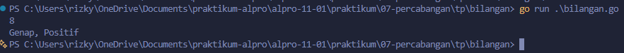
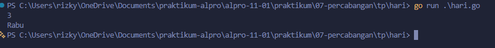
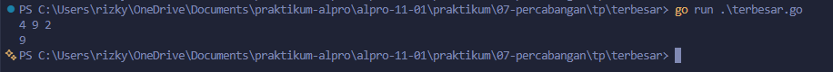

# <h1 align="center">Tugas Pendahuluan Modul 07 - “PERCABANGAN”</h1>
<p align="center">[Rizky Fadlurrahman ramadhan] - [109092630002]</p>

### 1. bilangan.go

```go
package main

import "fmt"

func main() {
	var n int
	fmt.Scan(&n)

	if n == 0 {
		fmt.Println("Nol")
	} else {
		var jenis, tanda string

		if n%2 == 0 {
			jenis = "Genap"
		} else {
			jenis = "Ganjil"
		}

		if n > 0 {
			tanda = "Positif"
		} else {
			tanda = "Negatif"
		}

		fmt.Println(jenis + ", " + tanda)
	}
}
```

##### Output


#### Deskripsi
Program ini menentukan bilangan genap atau ganjil dan positif atau negatif. Angka 0 dicek paling awal dan dicetak "Nol". Untuk angka lain, `n%2 == 0` menentukan genap atau ganjil, dan `n > 0` menentukan positif atau negatif.

### 2. hari.go

```go
package main

import "fmt"

func main() {
	var hari int
	fmt.Scan(&hari)

	switch hari {
	case 1:
		fmt.Println("Senin")
	case 2:
		fmt.Println("Selasa")
	case 3:
		fmt.Println("Rabu")
	case 4:
		fmt.Println("Kamis")
	case 5:
		fmt.Println("Jumat")
	case 6:
		fmt.Println("Sabtu")
	case 7:
		fmt.Println("Minggu")
	default:
		fmt.Println("Nomor hari tidak valid")
	}
}
```

##### Output


#### Deskripsi
Program ini mengubah nomor hari (1 sampai 7) menjadi nama hari memakai `switch`. Nomor di luar rentang itu masuk ke `default` dan mencetak "Nomor hari tidak valid".

### 3. terbesar.go

```go
package main

import "fmt"

func main() {
	var a, b, c, maks int
	fmt.Scan(&a, &b, &c)

	if a >= b && a >= c {
		maks = a
	} else if b >= a && b >= c {
		maks = b
	} else {
		maks = c
	}

	fmt.Println(maks)
}
```

##### Output


#### Deskripsi
Program ini mencari bilangan terbesar dari tiga bilangan memakai `if - else if - else`. Tanda `>=` dipakai supaya kasus ada dua bilangan tertinggi yang sama tetap benar.

## Kesimpulan
Percabangan dipakai supaya program bisa memilih jalur sesuai kondisi. `if - else if` cocok untuk kondisi berupa perbandingan atau rentang, sedangkan `switch` lebih rapi kalau yang dicek adalah nilai tertentu seperti nomor hari. Di Go, `switch` tidak butuh `break` karena otomatis berhenti setelah satu `case` cocok.