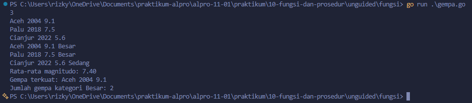
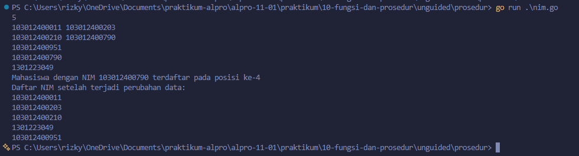

# <h1 align="center">Laporan Praktikum Modul 10 dan 11 - “FUNGSI DAN PROSEDUR”</h1>
<p align="center">[Rizky Fadlurrahman Ramadhan] - [109092630002]</p>

## Dasar Teori

### A. Fungsi
Fungsi adalah subprogram yang mengerjakan satu tugas dan mengembalikan sebuah nilai lewat `return`, sehingga hasilnya bisa langsung dipakai pada ekspresi. Di Go, fungsi ditulis dengan `func nama(parameter) tipeKembali`

### B. Prosedur
Prosedur adalah subprogram yang tidak mengembalikan nilai, ditulis sebagai `func` tanpa tipe kembali. Prosedur dipakai untuk melakukan aksi seperti membaca data, mengubah array, atau mencetak hasil. Kondisi sebelum dan sesudah prosedur dijalankan dinyatakan dengan *Initial State* (IS) dan *Final State* (FS)

### C. Parameter dan Pointer
Parameter *in* dikirim *by value*, sedangkan parameter *out* atau *in/out* dikirim sebagai pointer (`*tipe` saat deklarasi dan `&variabel` saat pemanggilan) agar perubahannya terlihat di program pemanggil

### D. Struct dan Array
`struct` mengelompokkan data yang berkaitan dalam satu tipe, sedangkan array menyimpan banyak data bertipe sama. Gabungan keduanya (array of struct) dipakai untuk menyimpan kumpulan data seperti daftar player atau gempa

## Guided

### 1. player.go (Fungsi)

```go
package main

import "fmt"

const NMAX int = 999

type player struct {
	nickname string
	score    int
}

type tabPlayer [NMAX]player

func rataRata(T tabPlayer, n int) float64 {
	total := 0
	for i := 0; i < n; i++ {
		total += T[i].score
	}
	return float64(total) / float64(n)
}

func idxTertinggi(T tabPlayer, n int) int {
	idx := 0
	for i := 1; i < n; i++ {
		if T[i].score > T[idx].score {
			idx = i
		}
	}
	return idx
}

func hitungDiAtas(T tabPlayer, n int, batas float64) int {
	count := 0
	for i := 0; i < n; i++ {
		if float64(T[i].score) > batas {
			count++
		}
	}
	return count
}

func main() {
	var T tabPlayer
	var n int
	fmt.Scan(&n)
	for i := 0; i < n; i++ {
		fmt.Scan(&T[i].nickname, &T[i].score)
	}

	avg := rataRata(T, n)
	best := idxTertinggi(T, n)
	di := hitungDiAtas(T, n, avg)

	fmt.Printf("Rata-rata skor: %.2f\n", avg)
	fmt.Printf("Player terbaik: %s (%d)\n", T[best].nickname, T[best].score)
	fmt.Printf("Jumlah player di atas rata-rata: %d\n", di)
}
```

#### Deskripsi
Program membaca nickname dan skor setiap player, lalu menampilkan rata-rata skor, player terbaik, dan jumlah player di atas rata-rata. Tiap perhitungan dibuat dalam fungsi terpisah yang hasilnya dikembalikan ke program utama

### 2. sapi.go (Prosedur)

```go
package main

import "fmt"

const NMAX int = 10000

type Arr [NMAX]int

func bacaData(T *Arr, n int) {
	for i := 0; i < n; i++ {
		fmt.Scan(&T[i])
	}
}

func geserKanan(T *Arr, n int) {
	terakhir := T[n-1]
	for i := n - 1; i > 0; i-- {
		T[i] = T[i-1]
	}
	T[0] = terakhir
}

func cetak(T Arr, n int) {
	for i := 0; i < n; i++ {
		if i > 0 {
			fmt.Print(" ")
		}
		fmt.Print(T[i])
	}
	fmt.Println()
}

func main() {
	var T Arr
	var n, k int
	fmt.Scan(&n, &k)
	bacaData(&T, n)

	for i := 0; i < k%n; i++ {
		geserKanan(&T, n)
	}
	cetak(T, n)
}
```

#### Deskripsi
Program menampilkan susunan sapi setelah K hari, dengan sapi bergeser satu kandang ke kanan setiap harinya. Karena K bisa sangat besar, pergeseran cukup dilakukan sebanyak `K mod N` kali sebab susunan kembali seperti semula setiap N hari

## Unguided

### 1. gempa.go (Fungsi)

```go
package main

import "fmt"

const NMAX int = 999

type gempa struct {
	nama      string
	tahun     int
	magnitudo float64
}

type tabGempa [NMAX]gempa

func kategori(m float64) string {
	if m < 4.0 {
		return "Minor"
	} else if m < 6.0 {
		return "Sedang"
	} else if m < 7.0 {
		return "Kuat"
	}
	return "Besar"
}

func rataMagnitudo(T tabGempa, n int) float64 {
	total := 0.0
	for i := 0; i < n; i++ {
		total += T[i].magnitudo
	}
	return total / float64(n)
}

func idxTerkuat(T tabGempa, n int) int {
	idx := 0
	for i := 1; i < n; i++ {
		if T[i].magnitudo > T[idx].magnitudo {
			idx = i
		}
	}
	return idx
}

func hitungKategori(T tabGempa, n int, k string) int {
	count := 0
	for i := 0; i < n; i++ {
		if kategori(T[i].magnitudo) == k {
			count++
		}
	}
	return count
}

func main() {
	var T tabGempa
	var n int
	fmt.Scan(&n)
	for i := 0; i < n; i++ {
		fmt.Scan(&T[i].nama, &T[i].tahun, &T[i].magnitudo)
	}

	for i := 0; i < n; i++ {
		fmt.Printf("%s %d %.1f %s\n", T[i].nama, T[i].tahun, T[i].magnitudo, kategori(T[i].magnitudo))
	}
	fmt.Printf("Rata-rata magnitudo: %.2f\n", rataMagnitudo(T, n))
	k := idxTerkuat(T, n)
	fmt.Printf("Gempa terkuat: %s %d %.1f\n", T[k].nama, T[k].tahun, T[k].magnitudo)
	fmt.Printf("Jumlah gempa kategori Besar: %d\n", hitungKategori(T, n, "Besar"))
}
```

##### Output


#### Deskripsi
Program membaca data gempa lalu menampilkan kategori tiap gempa, rata-rata magnitudo, gempa terkuat, dan jumlah gempa berkategori Besar. Fungsi `hitungKategori` memanggil fungsi `kategori` untuk menentukan kategori setiap gempa

### 2. nim.go (Prosedur)

```go
package main

import "fmt"

const NMAX int = 2002

type tabNIM [NMAX]int

func cariNIM(T tabNIM, n, x int, idx *int) {
	*idx = -1
	for i := 0; i < n && *idx == -1; i++ {
		if T[i] == x {
			*idx = i
		}
	}
}

func ubahNIM(T *tabNIM, idx, baru int) {
	T[idx] = baru
}

func cetak(T tabNIM, n int) {
	for i := 0; i < n; i++ {
		fmt.Println(T[i])
	}
}

func main() {
	var T tabNIM
	var n, x, baru, idx int
	fmt.Scan(&n)
	for i := 0; i < n; i++ {
		fmt.Scan(&T[i])
	}
	fmt.Scan(&x)

	cariNIM(T, n, x, &idx)
	if idx == -1 {
		fmt.Println("NIM tidak ditemukan dalam sistem")
	} else {
		fmt.Scan(&baru)
		fmt.Printf("Mahasiswa dengan NIM %d terdaftar pada posisi ke-%d\n", x, idx+1)
		ubahNIM(&T, idx, baru)
		fmt.Println("Daftar NIM setelah terjadi perubahan data:")
		cetak(T, n)
	}
}
```

##### Output


#### Deskripsi
Program mencari NIM pada daftar dan menggantinya dengan NIM baru jika ditemukan. Indeks hasil pencarian dikirim lewat pointer (-1 jika tidak ada), dan posisi yang ditampilkan adalah indeks + 1

## Kesimpulan
Fungsi dan prosedur membuat program lebih terstruktur dan mudah dipakai ulang. Fungsi mengembalikan nilai lewat `return` sehingga cocok untuk perhitungan, sedangkan prosedur tidak mengembalikan nilai dan cocok untuk aksi seperti membaca data atau mengubah array. Hasil prosedur dikirim lewat parameter pointer agar perubahannya terlihat di program pemanggil

## Referensi
1. The Go Authors. (2024). *The Go Programming Language Specification*. https://go.dev/ref/spec
2. Donovan, A. A., & Kernighan, B. W. (2015). *The Go Programming Language*. New York: Addison-Wesley
3. Laboratorium Praktikum Informatika. (2026). *Modul 10: Fungsi dan Modul 11: Prosedur - Algoritma dan Pemrograman 2*. Bandung: Fakultas Informatika, Universitas Telkom