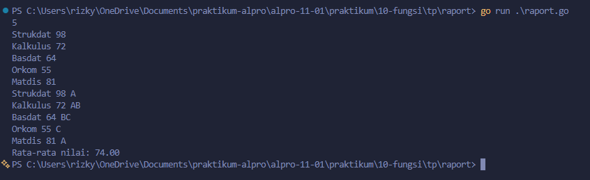
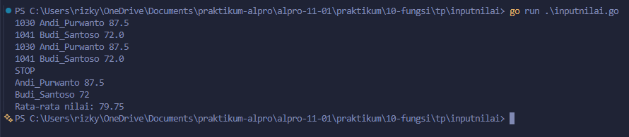
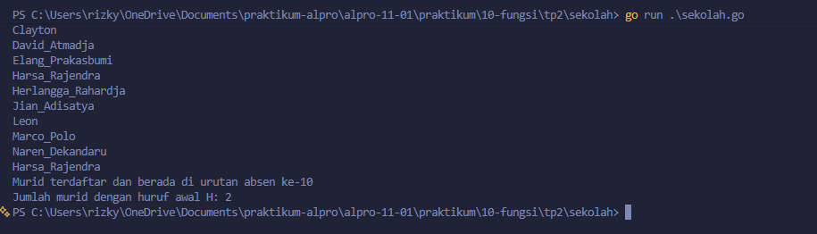
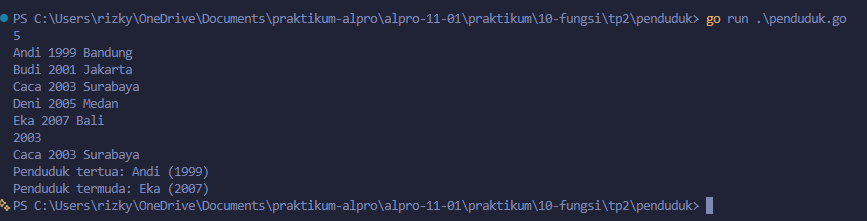

# <h1 align="center">Tugas Pendahuluan Modul 10 dan 11 - “FUNGSI DAN PROSEDUR”</h1>
<p align="center">[Rizky Fadlurrahman ramadhan] - [109092630002]</p>

## Modul 10 - FUNGSI

### 1. raport.go

```go
package main

import (
	"fmt"
)

const NMAX int = 999

type rapot struct {
	matkul string
	nilai  int
}

type tabRapot [NMAX]rapot

func nilaiHuruf(x int) string {
	if x > 80 {
		return "A"
	} else if x > 70 {
		return "AB"
	} else if x > 65 {
		return "B"
	} else if x > 60 {
		return "BC"
	} else if x > 50 {
		return "C"
	} else if x > 40 {
		return "D"
	} else {
		return "E"
	}
}

func rataRata(T tabRapot, n int) float64 {
	var total int = 0
	for i := 0; i < n; i++ {
		total += T[i].nilai
	}
	return float64(total) / float64(n)
}

func main() {
	var n int
	fmt.Scan(&n)

	var T tabRapot
	for i := 0; i < n; i++ {
		fmt.Scan(&T[i].matkul, &T[i].nilai)
	}

	for i := 0; i < n; i++ {
		fmt.Println(T[i].matkul, T[i].nilai, nilaiHuruf(T[i].nilai))
	}

	fmt.Printf("Rata-rata nilai: %.2f\n", rataRata(T, n))
}
```

##### Output


#### Deskripsi
Program membaca mata kuliah beserta nilainya, lalu menampilkan nilai huruf tiap mata kuliah dan rata-ratanya. Fungsi `nilaiHuruf` mengubah angka menjadi huruf, sedangkan `rataRata` menghitung rata-rata seluruh nilai

### 2. inputnilai.go

```go
package main

import (
	"fmt"
)

const NMAX int = 100

type student struct {
	nim, name string
	grade     float64
}

type students [NMAX]student

func cariNIM(T students, n int, nim string) int {
	for i := 0; i < n; i++ {
		if T[i].nim == nim {
			return i
		}
	}
	return -1
}

func rataRata(T students, n int) float64 {
	var total float64 = 0
	for i := 0; i < n; i++ {
		total += T[i].grade
	}
	return total / float64(n)
}

func main() {
	var T students
	var n int = 0
	var nim, name string
	var grade float64

	for {
		fmt.Scan(&nim)
		if nim == "STOP" {
			break
		}
		fmt.Scan(&name, &grade)

		if cariNIM(T, n, nim) == -1 {
			T[n].nim = nim
			T[n].name = name
			T[n].grade = grade
			n++
		}
	}
	for i := 0; i < n; i++ {
		fmt.Println(T[i].name, T[i].grade)
	}
	if n > 0 {
		fmt.Printf("Rata-rata nilai: %.2f\n", rataRata(T, n))
	}
}
```

##### Output


#### Deskripsi
Program membaca NIM, nama, dan nilai sampai NIM "STOP" dimasukkan. Fungsi `cariNIM` mengecek apakah NIM sudah ada, sehingga data ganda diabaikan. Setelah itu program menampilkan data unik dan rata-ratanya

## Kesimpulan
Fungsi memecah program menjadi bagian kecil yang mengembalikan hasil lewat `return`, sehingga nilainya bisa langsung dipakai di tempat pemanggilan. `struct` mengelompokkan data yang saling berkaitan

## Modul 11 - PROSEDUR

### 1. sekolah.go

```go
package main

import (
	"fmt"
)

const NMAX int = 1001

type tabMurid [NMAX]string

func cariMurid(T tabMurid, n int, nama string, posisi *int, ketemu *bool) {
	*ketemu = false
	*posisi = 0
	for i := 0; i < n; i++ {
		if T[i] == nama {
			*ketemu = true
			*posisi = i + 1
			break
		}
	}
}

func hitungHuruf(T tabMurid, n int, h byte, jumlah *int) {
	*jumlah = 0
	for i := 0; i < n; i++ {
		if len(T[i]) > 0 && T[i][0] == h {
			*jumlah++
		}
	}
}

func main() {
	var n int
	fmt.Scan(&n)

	var T tabMurid
	for i := 0; i < n; i++ {
		fmt.Scan(&T[i])
	}

	var cari string
	fmt.Scan(&cari)

	var posisi int
	var ketemu bool
	cariMurid(T, n, cari, &posisi, &ketemu)

	if ketemu {
		fmt.Printf("Murid terdaftar dan berada di urutan absen ke-%d\n", posisi)
	} else {
		fmt.Println("Murid tidak terdaftar")
	}

	var jumlah int
	var hurufAwal byte = cari[0]
	hitungHuruf(T, n, hurufAwal, &jumlah)
	fmt.Printf("Jumlah murid dengan huruf awal %c: %d\n", hurufAwal, jumlah)
}
```

##### Output


#### Deskripsi
Program menyimpan nama murid dalam array lalu mencari satu nama. Prosedur `cariMurid` mengirim nomor absen dan status ketemu lewat pointer, sedangkan `hitungHuruf` menghitung murid yang namanya berawalan huruf yang sama

### 2. penduduk.go

```go
package main

import (
	"fmt"
)

const NMAX int = 1000

type penduduk struct {
	nama  string
	tahun int
	kota  string
}

type tabPenduduk [NMAX]penduduk

func cariTahun(T tabPenduduk, n, th int, idx *int) {
	*idx = -1
	for i := 0; i < n; i++ {
		if T[i].tahun == th {
			*idx = i
			break
		}
	}
}

func tertuaTermuda(T tabPenduduk, n int, tua, muda *penduduk) {
	*tua = T[0]
	*muda = T[0]
	for i := 1; i < n; i++ {
		if T[i].tahun < tua.tahun {
			*tua = T[i]
		}
		if T[i].tahun > muda.tahun {
			*muda = T[i]
		}
	}
}

func main() {
	var n int
	fmt.Scan(&n)

	var T tabPenduduk
	for i := 0; i < n; i++ {
		fmt.Scan(&T[i].nama, &T[i].tahun, &T[i].kota)
	}

	var thCari int
	fmt.Scan(&thCari)

	var idx int
	cariTahun(T, n, thCari, &idx)

	if idx != -1 {
		fmt.Printf("%s %d %s\n", T[idx].nama, T[idx].tahun, T[idx].kota)
	} else {
		fmt.Println("Data tidak ditemukan")
	}

	var tua, muda penduduk
	tertuaTermuda(T, n, &tua, &muda)

	fmt.Printf("Penduduk tertua: %s (%d)\n", tua.nama, tua.tahun)
	fmt.Printf("Penduduk termuda: %s (%d)\n", muda.nama, muda.tahun)
}
```

##### Output


#### Deskripsi
Program menyimpan data penduduk (nama, tahun, kota) dalam array struct. Prosedur `cariTahun` mencari data dengan tahun tertentu, dan `tertuaTermuda` menentukan penduduk dengan tahun terkecil dan terbesar. Hasilnya dikirim lewat pointer

## Kesimpulan
Prosedur memecah program menjadi bagian kecil dan mengirim hasil lewat parameter pointer (`*` pada deklarasi, `&` saat dipanggil). `struct` mengelompokkan data yang saling berkaitan dalam satu tipe