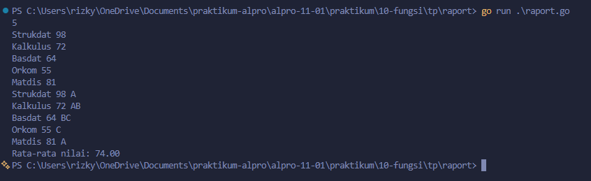
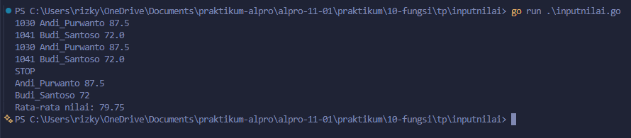

# <h1 align="center">Tugas Pendahuluan Modul 10 - “FUNGSI”</h1>
<p align="center">[Rizky Fadlurrahman ramadhan] - [109092630002]</p>

### 1. raport.go

```go
package main

import (
	"fmt"
)

const NMAX int = 999

type rapot struct {
	matkul string
	nilai  int
}

type tabRapot [NMAX]rapot

func nilaiHuruf(x int) string {
	if x > 80 {
		return "A"
	} else if x > 70 {
		return "AB"
	} else if x > 65 {
		return "B"
	} else if x > 60 {
		return "BC"
	} else if x > 50 {
		return "C"
	} else if x > 40 {
		return "D"
	} else {
		return "E"
	}
}

func rataRata(T tabRapot, n int) float64 {
	var total int = 0
	for i := 0; i < n; i++ {
		total += T[i].nilai
	}
	return float64(total) / float64(n)
}

func main() {
	var n int
	fmt.Scan(&n)

	var T tabRapot
	for i := 0; i < n; i++ {
		fmt.Scan(&T[i].matkul, &T[i].nilai)
	}

	for i := 0; i < n; i++ {
		fmt.Println(T[i].matkul, T[i].nilai, nilaiHuruf(T[i].nilai))
	}

	fmt.Printf("Rata-rata nilai: %.2f\n", rataRata(T, n))
}
```

##### Output


#### Deskripsi
Program membaca mata kuliah beserta nilainya, lalu menampilkan nilai huruf tiap mata kuliah dan rata-ratanya. Fungsi `nilaiHuruf` mengubah angka menjadi huruf, sedangkan `rataRata` menghitung rata-rata seluruh nilai

### 2. inputnilai.go

```go
package main

import (
	"fmt"
)

const NMAX int = 100

type student struct {
	nim, name string
	grade     float64
}

type students [NMAX]student

func cariNIM(T students, n int, nim string) int {
	for i := 0; i < n; i++ {
		if T[i].nim == nim {
			return i
		}
	}
	return -1
}

func rataRata(T students, n int) float64 {
	var total float64 = 0
	for i := 0; i < n; i++ {
		total += T[i].grade
	}
	return total / float64(n)
}

func main() {
	var T students
	var n int = 0
	var nim, name string
	var grade float64

	for {
		fmt.Scan(&nim)
		if nim == "STOP" {
			break
		}
		fmt.Scan(&name, &grade)

		if cariNIM(T, n, nim) == -1 {
			T[n].nim = nim
			T[n].name = name
			T[n].grade = grade
			n++
		}
	}
	for i := 0; i < n; i++ {
		fmt.Println(T[i].name, T[i].grade)
	}
	if n > 0 {
		fmt.Printf("Rata-rata nilai: %.2f\n", rataRata(T, n))
	}
}
```

##### Output


#### Deskripsi
Program membaca NIM, nama, dan nilai sampai NIM "STOP" dimasukkan. Fungsi `cariNIM` mengecek apakah NIM sudah ada, sehingga data ganda diabaikan. Setelah itu program menampilkan data unik dan rata-ratanya

## Kesimpulan
Fungsi memecah program menjadi bagian kecil yang mengembalikan hasil lewat `return`, sehingga nilainya bisa langsung dipakai di tempat pemanggilan. `struct` mengelompokkan data yang saling berkaitan