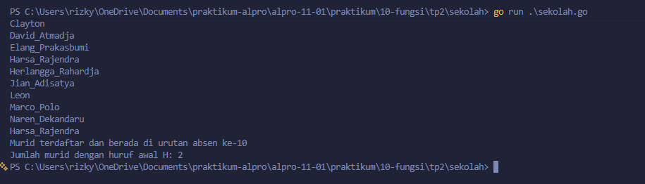
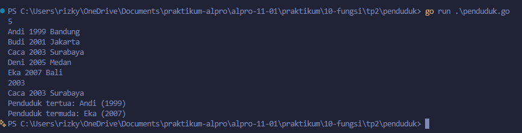

# <h1 align="center">Tugas Pendahuluan Modul 11 - “PROSEDUR”</h1>
<p align="center">[Rizky Fadlurrahman ramadhan] - [109092630002]</p>

### 1. sekolah.go

```go
package main

import (
	"fmt"
)

const NMAX int = 1001

type tabMurid [NMAX]string

func cariMurid(T tabMurid, n int, nama string, posisi *int, ketemu *bool) {
	*ketemu = false
	*posisi = 0
	for i := 0; i < n; i++ {
		if T[i] == nama {
			*ketemu = true
			*posisi = i + 1
			break
		}
	}
}

func hitungHuruf(T tabMurid, n int, h byte, jumlah *int) {
	*jumlah = 0
	for i := 0; i < n; i++ {
		if len(T[i]) > 0 && T[i][0] == h {
			*jumlah++
		}
	}
}

func main() {
	var n int
	fmt.Scan(&n)

	var T tabMurid
	for i := 0; i < n; i++ {
		fmt.Scan(&T[i])
	}

	var cari string
	fmt.Scan(&cari)

	var posisi int
	var ketemu bool
	cariMurid(T, n, cari, &posisi, &ketemu)

	if ketemu {
		fmt.Printf("Murid terdaftar dan berada di urutan absen ke-%d\n", posisi)
	} else {
		fmt.Println("Murid tidak terdaftar")
	}

	var jumlah int
	var hurufAwal byte = cari[0]
	hitungHuruf(T, n, hurufAwal, &jumlah)
	fmt.Printf("Jumlah murid dengan huruf awal %c: %d\n", hurufAwal, jumlah)
}
```

##### Output


#### Deskripsi
Program menyimpan nama murid dalam array lalu mencari satu nama. Prosedur `cariMurid` mengirim nomor absen dan status ketemu lewat pointer, sedangkan `hitungHuruf` menghitung murid yang namanya berawalan huruf yang sama

### 2. penduduk.go

```go
package main

import (
	"fmt"
)

const NMAX int = 1000

type penduduk struct {
	nama  string
	tahun int
	kota  string
}

type tabPenduduk [NMAX]penduduk

func cariTahun(T tabPenduduk, n, th int, idx *int) {
	*idx = -1
	for i := 0; i < n; i++ {
		if T[i].tahun == th {
			*idx = i
			break
		}
	}
}

func tertuaTermuda(T tabPenduduk, n int, tua, muda *penduduk) {
	*tua = T[0]
	*muda = T[0]
	for i := 1; i < n; i++ {
		if T[i].tahun < tua.tahun {
			*tua = T[i]
		}
		if T[i].tahun > muda.tahun {
			*muda = T[i]
		}
	}
}

func main() {
	var n int
	fmt.Scan(&n)

	var T tabPenduduk
	for i := 0; i < n; i++ {
		fmt.Scan(&T[i].nama, &T[i].tahun, &T[i].kota)
	}

	var thCari int
	fmt.Scan(&thCari)

	var idx int
	cariTahun(T, n, thCari, &idx)

	if idx != -1 {
		fmt.Printf("%s %d %s\n", T[idx].nama, T[idx].tahun, T[idx].kota)
	} else {
		fmt.Println("Data tidak ditemukan")
	}

	var tua, muda penduduk
	tertuaTermuda(T, n, &tua, &muda)

	fmt.Printf("Penduduk tertua: %s (%d)\n", tua.nama, tua.tahun)
	fmt.Printf("Penduduk termuda: %s (%d)\n", muda.nama, muda.tahun)
}
```

##### Output


#### Deskripsi
Program menyimpan data penduduk (nama, tahun, kota) dalam array struct. Prosedur `cariTahun` mencari data dengan tahun tertentu, dan `tertuaTermuda` menentukan penduduk dengan tahun terkecil dan terbesar. Hasilnya dikirim lewat pointer

## Kesimpulan
Prosedur memecah program menjadi bagian kecil dan mengirim hasil lewat parameter pointer (`*` pada deklarasi, `&` saat dipanggil). `struct` mengelompokkan data yang saling berkaitan dalam satu tipe