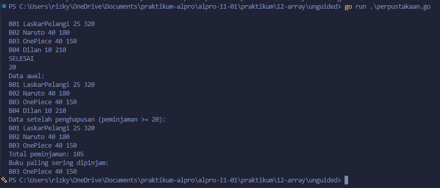

# <h1 align="center">Laporan Praktikum Modul 12 - “ARRAY”</h1>
<p align="center">[Rizky Fadlurrahman Ramadhan] - [109092630002]</p>

## Dasar Teori

### A. Array
Array adalah struktur data yang menyimpan banyak nilai bertipe sama dalam satu variabel, dan setiap nilainya diakses lewat indeks. Di Go, array berukuran tetap dan indeksnya dimulai dari 0, sehingga array `[NMAX]tipe` memiliki indeks 0 sampai NMAX-1. Karena ukurannya tetap, biasanya dipakai konstanta `NMAX` sebagai kapasitas dan variabel `n` untuk menyimpan jumlah elemen yang benar-benar terisi

### B. Array pada Subprogram
Array yang dikirim ke subprogram akan disalin (*by value*), sehingga perubahan di dalam subprogram tidak terlihat di pemanggil. Jika isi array perlu diubah, array dikirim sebagai pointer (`*tipeArray` pada deklarasi dan `&variabel` saat pemanggilan), sedangkan elemennya tetap diakses dengan `A[i]`

### C. Operasi Dasar pada Array
- **Pencarian nilai ekstrim:** menelusuri array sambil menyimpan indeks nilai terbesar atau terkecil. Jika memakai `>` atau `<` saja, indeks yang pertama muncul yang dipilih saat ada nilai sama
- **Pembalikan:** menukar elemen ke-`i` dengan elemen ke-`n-1-i` sampai tengah array, tanpa array bantuan
- **Penghapusan:** menggeser seluruh elemen setelah posisi yang dihapus satu langkah ke kiri, lalu mengurangi `n`. Penyisipan dilakukan sebaliknya, yaitu menggeser elemen ke kanan

### D. Array of Struct
Array dapat berisi struct, misalnya data buku yang terdiri dari kode, judul, jumlah peminjaman, dan jumlah halaman. Setiap field diakses dengan `A[i].field`, dan satu elemen dapat disalin utuh ke elemen lain

## Guided

### 1. curah.go

```go
package main

import "fmt"

const NMAX int = 9999

type arrReal [NMAX]float64

// Procedure bacaData(in/out A : arrReal, in n : integer)
func bacaData(A *arrReal, n int) {
	for i := 0; i < n; i++ {
		fmt.Scan(&A[i])
	}
}

// Procedure cetakData(in A : arrReal, in n : integer)
func cetakData(A arrReal, n int) {
	for i := 0; i < n; i++ {
		if i == n-1 {
			fmt.Printf("%.1f.\n", A[i])
		} else {
			fmt.Printf("%.1f, ", A[i])
		}
	}
}

// Procedure cariMaksMin(in A : arrReal, in n : integer, out iMaks, iMin : integer)
func cariMaksMin(A arrReal, n int, iMaks, iMin *int) {
	*iMaks = 0
	*iMin = 0
	for i := 1; i < n; i++ {
		// Menggunakan > dan < (bukan >= atau <=) agar jika ada nilai sama, indeks pertama yang diambil
		if A[i] > A[*iMaks] {
			*iMaks = i
		}
		if A[i] < A[*iMin] {
			*iMin = i
		}
	}
}

// Function rataRata(A : arrReal, n : integer) -> real
func rataRata(A arrReal, n int) float64 {
	var total float64 = 0
	for i := 0; i < n; i++ {
		total += A[i]
	}
	return total / float64(n)
}

// Procedure balikData(in/out A : arrReal, in n : integer)
func balikData(A *arrReal, n int) {
	var temp float64
	for i := 0; i < n/2; i++ {
		temp = A[i]
		A[i] = A[n-1-i]
		A[n-1-i] = temp
	}
}

func main() {
	var data arrReal
	var n, iMaks, iMin int

	// Baca banyaknya data N
	fmt.Scan(&n)

	// Validasi batas N sesuai soal (1 <= N <= 9999)
	if n >= 1 && n <= NMAX {
		// 1. Baca N data curah hujan
		bacaData(&data, n)

		// 2. Cetak data awal
		fmt.Print("Data awal: ")
		cetakData(data, n)

		// 3. Cari dan cetak nilai tertinggi & terendah beserta posisinya (indeks + 1)
		cariMaksMin(data, n, &iMaks, &iMin)
		fmt.Printf("Tertinggi: %.1f (data ke-%d)\n", data[iMaks], iMaks+1)
		fmt.Printf("Terendah: %.1f (data ke-%d)\n", data[iMin], iMin+1)

		// 4. Hitung dan cetak rata-rata (2 angka di belakang koma)
		fmt.Printf("Rata-rata: %.2f\n", rataRata(data, n))

		// 5. Balik urutan elemen tanpa array bantuan dan cetak hasilnya
		balikData(&data, n)
		fmt.Print("Data setelah dibalik: ")
		cetakData(data, n)
	}
}
```

#### Deskripsi
Program menyimpan data curah hujan dalam array lalu menampilkan data awal, nilai tertinggi dan terendah beserta posisinya, rata-rata, dan data setelah dibalik. Pembalikan dilakukan dengan menukar elemen dari ujung ke tengah tanpa array bantuan, dan array yang berubah dikirim sebagai pointer

## Unguided

### 1. perpustakaan.go

```go
package main

import "fmt"

const NMAX = 100

type book struct {
	code, title string
	borrowed    int
	pages       int
}

type books [NMAX]book

// membaca data buku sampai kode "SELESAI"
func bacaData(T *books, n *int) {
	var kode string
	*n = 0
	for {
		if _, err := fmt.Scan(&kode); err != nil || kode == "SELESAI" {
			break
		}
		var b book
		b.code = kode
		fmt.Scan(&b.title, &b.borrowed, &b.pages)
		if *n < NMAX {
			T[*n] = b
			*n++
		}
	}
}

func cetakData(T books, n int) {
	for i := 0; i < n; i++ {
		fmt.Printf("%s %s %d %d\n", T[i].code, T[i].title, T[i].borrowed, T[i].pages)
	}
}

// IS : T[0..n-1] dan x terdefinisi
// FS : semua buku dengan borrowed < x terhapus dengan menggeser elemen
//      setelahnya ke kiri; urutan buku tersisa tetap; n berkurang
func hapusBuku(T *books, n *int, x int) {
	i := 0
	for i < *n {
		if T[i].borrowed < x {
			for j := i; j < *n-1; j++ {
				T[j] = T[j+1]
			}
			*n--
		} else {
			i++
		}
	}
}

func totalPinjam(T books, n int) int {
	total := 0
	for i := 0; i < n; i++ {
		total += T[i].borrowed
	}
	return total
}

// indeks buku dengan peminjaman terbanyak; jika sama, pilih halaman lebih sedikit
func idxFavorit(T books, n int) int {
	idx := 0
	for i := 1; i < n; i++ {
		if T[i].borrowed > T[idx].borrowed ||
			(T[i].borrowed == T[idx].borrowed && T[i].pages < T[idx].pages) {
			idx = i
		}
	}
	return idx
}

func main() {
	var T books
	var n, x int

	bacaData(&T, &n)
	fmt.Scan(&x)

	fmt.Println("Data awal:")
	cetakData(T, n)

	hapusBuku(&T, &n, x)
	fmt.Printf("Data setelah penghapusan (peminjaman >= %d):\n", x)
	if n == 0 {
		fmt.Println("Tidak ada buku tersisa")
		return
	}
	cetakData(T, n)

	fmt.Printf("Total peminjaman: %d\n", totalPinjam(T, n))
	f := idxFavorit(T, n)
	fmt.Println("Buku paling sering dipinjam:")
	fmt.Printf("%s %s %d %d\n", T[f].code, T[f].title, T[f].borrowed, T[f].pages)
}
```

##### Output


#### Deskripsi
Program membaca data buku sampai kode `SELESAI`, menghapus buku yang peminjamannya kurang dari X, lalu menampilkan total peminjaman dan buku paling sering dipinjam. Penghapusan dilakukan dengan menggeser elemen setelahnya ke kiri, dan jika peminjaman sama dipilih buku dengan halaman lebih sedikit

## Kesimpulan
Array memungkinkan banyak data disimpan dan diolah dengan perulangan lewat indeks. Operasi seperti mencari nilai ekstrim, membalik, dan menghapus elemen dapat dibuat sebagai subprogram, dengan pointer untuk array yang isinya berubah. Kombinasi array dan struct membuat pengelolaan data yang terdiri dari beberapa field menjadi lebih rapi

## Referensi
1. The Go Authors. (2024). *The Go Programming Language Specification*. https://go.dev/ref/spec
2. Donovan, A. A., & Kernighan, B. W. (2015). *The Go Programming Language*. New York: Addison-Wesley
3. Laboratorium Praktikum Informatika. (2026). *Modul 12: Array - Algoritma dan Pemrograman 2*. Bandung: Fakultas Informatika, Universitas Telkom