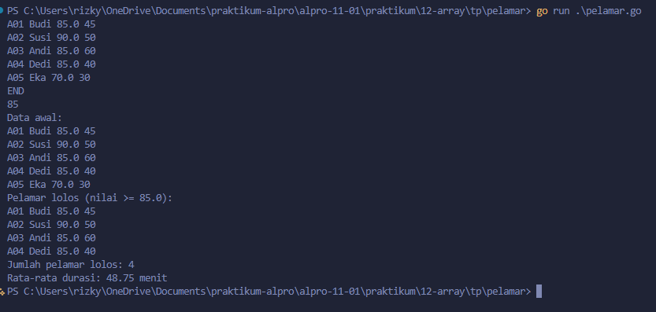
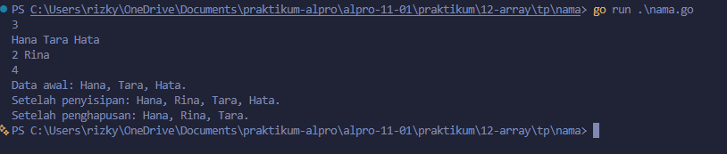

# <h1 align="center">Tugas Pendahuluan Modul 12 - “ARRAY”</h1>
<p align="center">[Rizky Fadlurrahman Ramadhan] - [109092630002]</p>

## Modul 12 - ARRAY

### 1. pelamar.go

```go
package main

import "fmt"

const NMAX = 100

type applicant struct {
	id, name     string
	testGrade    float64
	testDuration int
}

type applicants [NMAX]applicant

// IS : A[0..n-1] dan batas terdefinisi
// FS : B[0..m-1] berisi pelamar dari A dengan testGrade >= batas,
//      sesuai urutan kemunculan pada A
func salinLolos(A applicants, n int, batas float64, B *applicants, m *int) {
	*m = 0
	for i := 0; i < n; i++ {
		if A[i].testGrade >= batas {
			B[*m] = A[i]
			*m++
		}
	}
}

// mengembalikan rata-rata durasi pengerjaan dari m pelamar
func rataDurasi(B applicants, m int) float64 {
	total := 0
	for i := 0; i < m; i++ {
		total += B[i].testDuration
	}
	return float64(total) / float64(m)
}

func cetakData(A applicants, n int) {
	for i := 0; i < n; i++ {
		fmt.Printf("%s %s %.1f %d\n", A[i].id, A[i].name, A[i].testGrade, A[i].testDuration)
	}
}

func main() {
	var A, B applicants
	var n, m int
	var batas float64
	var id string

	// masukan dihentikan dengan "END"
	for {
		if _, err := fmt.Scan(&id); err != nil || id == "END" {
			break
		}
		var p applicant
		p.id = id
		fmt.Scan(&p.name, &p.testGrade, &p.testDuration)
		if n < NMAX {
			A[n] = p
			n++
		}
	}
	fmt.Scan(&batas)

	salinLolos(A, n, batas, &B, &m)

	fmt.Println("Data awal:")
	cetakData(A, n)

	fmt.Printf("Pelamar lolos (nilai >= %.1f):\n", batas)
	if m == 0 {
		fmt.Println("Tidak ada pelamar yang lolos")
	} else {
		cetakData(B, m)
		fmt.Printf("Jumlah pelamar lolos: %d\n", m)
		fmt.Printf("Rata-rata durasi: %.2f menit\n", rataDurasi(B, m))
	}
}
```

##### Output


#### Deskripsi
Program membaca data pelamar sampai ID `END` lalu membaca batas nilai kelulusan. Prosedur `salinLolos` menyalin pelamar dengan nilai di atas atau sama dengan batas ke array kedua, dan fungsi `rataDurasi` menghitung rata-rata durasi pengerjaan pelamar yang lolos. Jika tidak ada yang lolos, program menampilkan pesan khusus

### 2. nama.go

```go
package main

import "fmt"

const NMAX = 9999

type arrString [NMAX]string

func bacaData(A *arrString, n int) {
	for i := 0; i < n; i++ {
		fmt.Scan(&A[i])
	}
}

// FS : seluruh elemen tampil dipisahkan koma dan diakhiri titik
func cetakData(A arrString, n int) {
	for i := 0; i < n; i++ {
		if i > 0 {
			fmt.Print(", ")
		}
		fmt.Print(A[i])
	}
	fmt.Println(".")
}

// IS : A[0..n-1] terdefinisi, 1 <= p <= n+1
// FS : x berada pada posisi ke-p, elemen setelahnya bergeser ke kanan,
//      n bertambah 1
func sisipData(A *arrString, n *int, p int, x string) {
	for i := *n; i > p-1; i-- {
		A[i] = A[i-1]
	}
	A[p-1] = x
	*n++
}

// IS : A[0..n-1] terdefinisi, 1 <= q <= n
// FS : elemen pada posisi ke-q terhapus, elemen setelahnya bergeser
//      ke kiri, n berkurang 1
func hapusData(A *arrString, n *int, q int) {
	for i := q - 1; i < *n-1; i++ {
		A[i] = A[i+1]
	}
	*n--
}

func main() {
	var A arrString
	var n, p, q int
	var x string

	fmt.Scan(&n)
	bacaData(&A, n)
	fmt.Scan(&p, &x)
	fmt.Scan(&q)

	fmt.Print("Data awal: ")
	cetakData(A, n)

	sisipData(&A, &n, p, x)
	fmt.Print("Setelah penyisipan: ")
	cetakData(A, n)

	hapusData(&A, &n, q)
	fmt.Print("Setelah penghapusan: ")
	cetakData(A, n)
}
```

##### Output


#### Deskripsi
Program membaca sejumlah nama ke dalam array, menyisipkan satu nama pada posisi tertentu, lalu menghapus satu elemen pada posisi tertentu. Prosedur `sisipData` menggeser elemen ke kanan sebelum menaruh nama baru, sedangkan `hapusData` menggeser elemen ke kiri. Posisi pada soal dimulai dari 1, sehingga indeks array dikurangi 1

## Kesimpulan
Array dapat menyimpan banyak data sekaligus dan diolah lewat indeks. Menyalin sebagian data ke array lain, menyisipkan, dan menghapus elemen dilakukan dengan menggeser elemen, dan array yang isinya berubah dikirim ke subprogram sebagai pointer. `struct` mengelompokkan data pelamar dalam satu tipe sehingga bisa disimpan dalam array